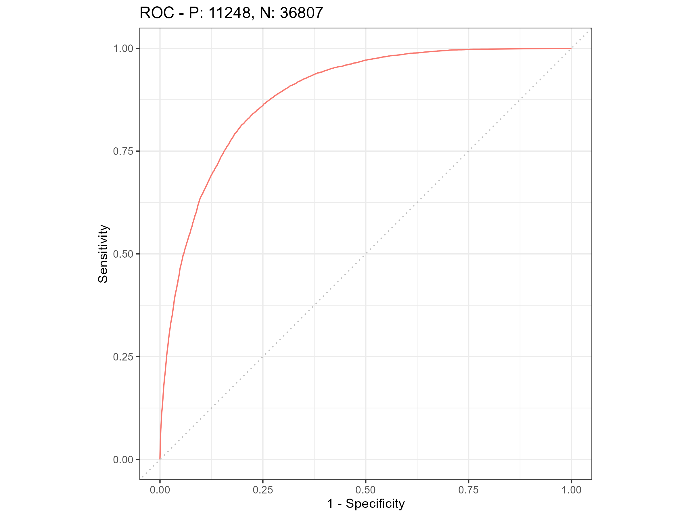
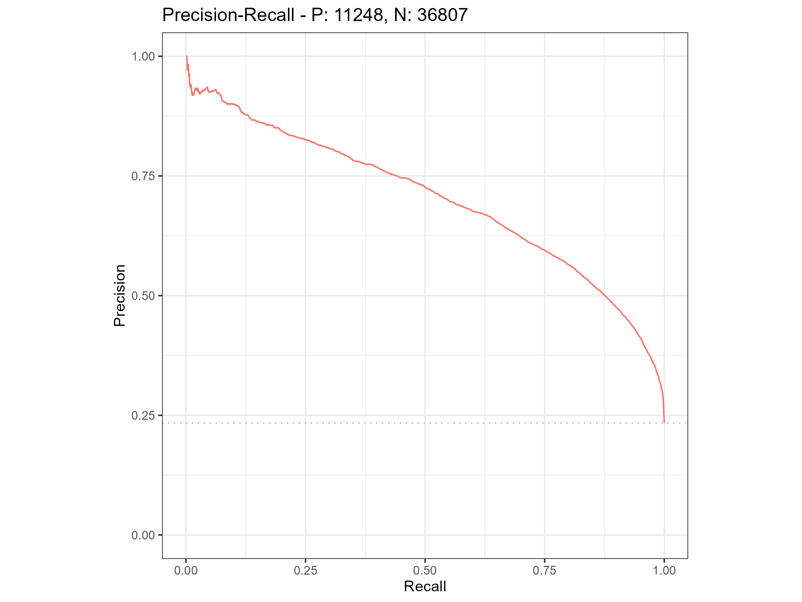

# m6APrediction

## Overview

`m6APrediction` is an R package designed to predict N6-methyladenosine (m6A) sites using a trained Random Forest model.

The package provides two main functions:

- `prediction_multiple()`: predicts m6A probabilities and classification results for multiple candidate sites.
- `prediction_single()`: predicts the probability and classification status of an individual candidate site.

By integrating sequence-related and transcript-related features, this package provides a convenient computational approach for identifying potential m6A modification sites.

## Scientific Background

N6-methyladenosine (m6A) is one of the most abundant internal modifications found in eukaryotic messenger RNA (mRNA). It plays important roles in various biological processes, including RNA stability, splicing, translation, and gene expression regulation.

Identifying potential m6A modification sites is therefore important for understanding post-transcriptional gene regulation.

Computational prediction methods can help screen candidate m6A sites and provide useful information for further experimental investigation.

## Model Description

This package uses a pre-trained Random Forest model to predict whether a candidate site is likely to be m6A-modified.

The model uses seven input features:

- `gc_content`: GC content of the sequence.
- `RNA_type`: RNA transcript type.
- `RNA_region`: Region of the RNA transcript.
- `exon_length`: Exon length.
- `distance_to_junction`: Distance to the nearest exon junction.
- `evolutionary_conservation`: Evolutionary conservation score.
- `DNA_5mer`: Five-nucleotide sequence surrounding the candidate site.

The trained model is included in the package under `inst/extdata`.

## Installation

You can install the package from GitHub using `remotes`:

```r
install.packages("remotes")
remotes::install_github("Pinxiliu/m6APrediction")
```

## Functions and Usage

### 1. Multiple-sequence prediction

`prediction_multiple()` predicts m6A probabilities and classification statuses for multiple candidate sites supplied in a data frame.

```r
library(m6APrediction)

model_path <- system.file(
  "extdata", "rf_fit.rds",
  package = "m6APrediction"
)

data_path <- system.file(
  "extdata", "m6A_input_example.csv",
  package = "m6APrediction"
)

ml_fit <- readRDS(model_path)
feature_df <- read.csv(data_path)

results <- prediction_multiple(
  ml_fit = ml_fit,
  feature_df = head(feature_df, 3)
)

print(results)
```

### 2. Single-sequence prediction

`prediction_single()` predicts the m6A probability and classification status for one candidate site.

```r
library(m6APrediction)

model_path <- system.file(
  "extdata", "rf_fit.rds",
  package = "m6APrediction"
)

ml_fit <- readRDS(model_path)

result <- prediction_single(
  ml_fit = ml_fit,
  gc_content = 0.6,
  RNA_type = "mRNA",
  RNA_region = "CDS",
  exon_length = 12,
  distance_to_junction = 5,
  evolutionary_conservation = 0.8,
  DNA_5mer = "GGACA",
  positive_threshold = 0.5
)

print(result)
```

## Prediction Output

Both prediction functions return two additional prediction fields:

- `predicted_m6A_prob`: predicted probability of the candidate site being m6A-positive.
- `predicted_m6A_status`: predicted classification status (`Positive` or `Negative`).

By default, a probability greater than 0.5 is classified as `Positive`; otherwise, it is classified as `Negative`.

For `prediction_multiple()`, the prediction results are added to the original input data frame.

For `prediction_single()`, the function returns a named vector containing the predicted probability and classification status.

The classification threshold can be adjusted using the `positive_threshold` argument.

## Scientific Value and Model Performance

The package provides a convenient computational tool for screening potential m6A modification sites using sequence-related and transcript-related information.

The predicted probabilities can help prioritize candidate sites for further investigation and experimental validation.

Model performance can be illustrated using Receiver Operating Characteristic (ROC) and Precision-Recall Curve (PRC) analyses.

### ROC Curve

The ROC curve evaluates the model's ability to distinguish between positive and negative m6A sites.

**ROC AUC = 0.8873**



### Precision-Recall Curve

The Precision-Recall curve evaluates the model's performance in identifying positive m6A sites.

**AUPRC = 0.7022**



## License

This package is released under the MIT License.
